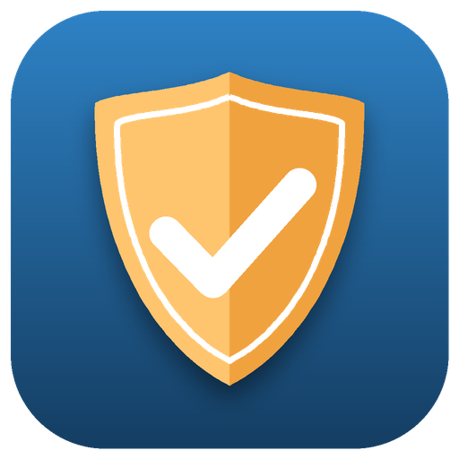

# GuardHawk



**Free, open-source, self-hosted environmental, health & safety (EHS) and fleet safety software.**
No subscriptions, no per-employee pricing, no contracts — run it on hardware you own.

*Formerly **Guardrail EHS**. Updating from Guardrail keeps all your records, settings and attached files.*

> **Status: preview (v0.15.0).** Windows desktop app with a modern look: grouped sidebar navigation, floating dialogs, smooth page transitions and light/dark mode. Every safety module, the full Fleet Hub, Crash Review AI and Safety References work today and save to your PC;
> the rest of the product is in place as "coming soon" pages. **GuardHawk Server** (optional, self-hosted) puts a whole team on the same data: see [server/](server/README.md).

## Working now

| Module | What you can do |
| --- | --- |
| **Incidents** | Report injuries and illnesses, environmental releases, property damage, motor vehicle incidents, operational liabilities and near misses. OSHA classification (first aid, medical treatment, restricted / transfer, days away, fatality), injury type, body part, days away and restricted, DOT recordable, root cause. Recordable, DART and lost-time cases are worked out for you. **Create action** opens a linked corrective action. |
| **Audits & Inspections** | Checklists (three starters included: monthly workplace inspection, forklift pre-use, fire extinguisher monthly; add your own). Checklists can apply to specific sites, departments or equipment, and **Customize…** makes a version of any checklist for one of them; starting an inspection asks where first and offers the checklists made for it. Answer each item Pass / Fail / N/A with notes, save for later or complete. Scores ignore N/A. **Create actions** makes one action per failed item. |
| **Risk Assessment** | Task and hazard rated on a 5 × 5 likelihood × severity matrix before and after controls (1–4 Low, 5–9 Medium, 10–14 High, 15–25 Extreme), with a live heat map and review dates. |
| **Management of Change** | Process, equipment, material, people, procedure and facility changes: Requested → Under review → Approved → Implemented → Closed (or Rejected). Approval needs a risk assessment; temporary changes are flagged when their end date passes. |
| **Reports** | OSHA 300 log, OSHA 300A summary, incident rates by month, incidents by type and location, overdue actions, inspection findings, training expiring, compliance due, LOTO inspections due, products missing an SDS, open claims. Preview any report and export it to CSV. |
| **Actions** | Create, edit, close and delete corrective / preventive actions with owner, location, due date and priority. Overdue is detected automatically. Filter, search, export to CSV. |
| **Observations** | Report unsafe conditions, unsafe behaviors and good catches (reporter optional, for anonymous reports). **Create action** turns any observation into a linked, pre-filled action. Filter, search, export to CSV. |
| **Safety Training** | Log completed training per person with optional expiry. Status is worked out for you: Current, Expiring soon (30 days), Expired or No expiry. Filter, search, export to CSV. |
| **Regulatory Compliance** | EPA, OSHA, DOT, state and local requirements: permits, licenses, reports, inspections and plans, with reference number, owner and next due date. Status is worked out for you: Upcoming, Due soon (30 days), Overdue or Completed. **Mark done** rolls monthly, quarterly and yearly items forward to the next due date (one-time items close). Filter, search, export to CSV. |
| **Claims Register** | Workers' comp, auto, general liability and property claims: claimant, date of loss, carrier and claim number, adjuster, related incident, reserve and amount paid. Total incurred (paid + open reserve), days open and closed-this-year are worked out for you. Filter, search, export to CSV. |
| **Library** | Policies, procedures, programs, forms and training material. GuardHawk keeps its own copy of each file (so moving the original doesn't break it), with version, owner and next review date. **Open** opens the file; review reminders 30 days ahead. Filter, search, export to CSV. |
| **Monthly Data** | Hours worked, average headcount and fleet miles for each location and month: the exposure numbers OSHA incident rates are calculated from. Rolling 12-month totals; duplicate months are caught. Filter by year, search, export to CSV. |
| **Behavioral Observations** | Behavior-based safety (BBS) cards: task, focus area (PPE, body position, tools, housekeeping, procedures, driving), safe and at-risk counts and whether feedback was given. % safe is worked out per card and for the last 30 days. **Create action** turns at-risk findings into a linked action. |
| **Work Permits** | Hot work, confined space, working at height, excavation, electrical and line-break permits: who it's issued to, where, valid dates and precautions. Permits past their end date that weren't closed show as **Expired**; **Close out** finishes them. |
| **Lockout / Tagout** | Equipment-specific energy control procedures: energy sources, isolation points, an optional procedure document or photo, and the annual periodic inspection OSHA requires (1910.147). Statuses: Current, Due soon, Overdue, Not inspected. **Inspected today** records an inspection in one click. |
| **Safety Data Sheets** | Chemical inventory: product, manufacturer, signal word (Danger / Warning), hazards, location, quantity and the SDS file itself. **Open** shows the sheet; products without one are flagged **Missing SDS**. |
| **Fleet Hub** | **Overview** (everything overdue or due in 30 days across the fleet), **Driver Qualification** (license, medical certificate, annual MVR review, road test, DQ file document; Qualified / Expiring soon / Expired / Incomplete), **Accident Register** (49 CFR 390.15: injuries, fatalities, tow-away, hazmat, DOT recordable, preventability, dashcam video), **Vehicle Management** (registration, annual DOT inspection, odometer, in / out of service), **DVIR Inspections** (pre- and post-trip, defects put the unit out of service until a repair is certified), **Maintenance** (PM schedules that repeat, completing an annual DOT inspection updates the vehicle), **Hours of Service** (log reviews with 11-hour and 14-hour violations flagged), **DOT Compliance Audit** (a live mock audit across all of the above with readiness %, gaps and an exportable report) and **Fleet Reporting** (driver application status, DQ file status, vehicle maintenance and renewal status, DOT accident register, DVIR defects, HOS violations, fleet roster). |
| **Crash Review AI** | Give it dashcam or fixed-camera (CCTV) video and it works out who was most likely at fault, with no one clicking anything: videos you drop in, **web links** you paste (direct video links, Dropbox / Google Drive / OneDrive shares, pages with a video in them, and YouTube, Facebook, X, Vimeo and similar sites through [yt-dlp](https://github.com/yt-dlp/yt-dlp), downloaded once from its official releases with your permission), videos that land in a **watch folder**, and videos attached to accidents in the Accident Register. The report shows the verdict and confidence, **every party's share of the fault and the reasons**, the collision type, **where it happened**, the moment of impact, four key frames with the vehicles outlined, **every road user in the video** (and whether it was involved), **how the camera vehicle was driven** (speed, braking and reaction time, following distance, lane keeping, and phone use when the cab camera is recorded), the camera vehicle's speed over time and a timeline of what the AI saw. **Attach documents** — police reports, news stories, statements (PDF, Word, text, web pages, links, or photos and scans read with Windows' built-in text recognition) — and their citations, contributing factors and "who hit whom" are weighed with the video. Handles split-screen (cab + road) dashcams, bonnets and timestamp overlays, edited videos with cuts, and handheld footage. Runs entirely on your PC (see *How Crash Review AI works* below). |
| **Safety References** | Built-in and offline. **ERG lookup**: the whole 2024 *Emergency Response Guidebook* — type a UN/NA number or a name to get the orange guide (potential hazards, public safety, protective clothing, evacuation, fire, spill and first aid), the Table 1 initial isolation and protective action distances for highlighted materials, and Table 2 water-reactive warnings. **Hazmat placards** for every DOT class and division with its starting ERG guide and the 49 CFR 172.504 placarding rules. **GHS pictograms** and label elements, the **NFPA 704** diamond, the **hierarchy of controls**, **fire extinguisher classes** and PASS, **lockout/tagout** steps, **ANSI Z535** signal words, the **16 SDS sections**, **hours of service**, **post-accident testing**, the DOT accident definition, **OSHA reporting** deadlines and recordkeeping dates, **TRIR / DART / LTIR** formulas, an **OSHA topics** sheet (fall protection and ladders, training frequencies, noise, heat and cold stress, confined spaces, trenching, electrical clearances, forklifts, PPE standards, eyewash and first aid, required written programs and postings, 2026 penalty amounts, inspection priorities) and **24-hour emergency numbers** (CHEMTREC, NRC, Poison Control, CANUTEC, OSHA). |
| **Dashboard** | Live, by period (this year, last 12 months, last year) and location: days since the last recordable injury and vehicle incident, incidents by type, actions open / closed / overdue, OSHA classification breakdown, recordables by location, and TRIR, DART, LTIR, lost-time and restricted days rates and the accident frequency rate (from Monthly Data hours and miles). |
| **Locations** | Settings → Organization → **Locations**: your plants, offices, terminals and job sites with code, type, region and district (corporate → region → district → location), address, manager and headcount. Every Location field in GuardHawk offers the list (you can still type anything), the Dashboard filters by it, renaming a location updates every record that uses it, and names already typed into records can be added in one click. |
| **PIN / password protection** | Optional (off by default), in Settings. Encrypts your records and attached documents on this PC (AES-256-GCM; the key is protected by your PIN or password with PBKDF2-SHA256, 600,000 rounds) and asks for the PIN or password when GuardHawk opens and after it's left alone (5 minutes to 1 hour, or never). **Lock** in the sidebar or Ctrl+L locks it right away. A one-time **recovery key** opens it if the PIN or password is forgotten. Dashcam / CCTV videos are left as they are. |
| **Backup and restore** | Settings → Your data: **Back up…** saves everything as one .zip (encrypted when protection is on); **Restore…** swaps it back in, keeping your current data in a `data-before-restore` folder. |
| Appearance | Light / dark mode (header toggle, or Settings → Appearance → "Match Windows"). |

Records are saved as JSON in `%AppData%\Guardrail\data\` (encrypted when PIN / password protection is on) (Settings → Your data → **Open folder**);
files attached to Library documents, LOTO procedures and Safety Data Sheets are copied into `data\library\`, `data\loto\` and `data\sds\`.
Each save writes a temp file first and keeps a `.bak` copy, so a crash can't corrupt your records.

## How Crash Review AI works

1. **Find the road view.** Black bars are trimmed; split-screen and picture-in-picture recordings (cab camera + road camera side by side, stacked or inset) are detected; the road panel is analyzed and the cab panel is checked for a phone in the driver's hand.
2. **Detect and track.** [YOLOX-S](https://github.com/Megvii-BaseDetection/YOLOX) (Apache-2.0, running on OpenCV's DNN module on the CPU) finds cars, trucks, buses, motorcycles, bicycles, pedestrians, traffic lights and stop signs 10 times a second; GuardHawk tracks each one and reads paint colours and signal states. Things that never move with traffic (your own bonnet, the dashboard, reflections) are removed.
3. **Measure the camera.** Optical flow over the background tells whether the camera is fixed, handheld or in a moving vehicle, how fast that vehicle is going (relative), when it brakes, steers or stops, and when it's jolted by an impact. Scene cuts in edited videos are found and each piece is analyzed on its own.
4. **Find the collision.** An impact on the camera vehicle needs something close and closing in, a real jolt (or the picture breaking up) and the vehicle stopping; a collision between other road users needs two of them meeting at the same depth and one changing course or speed abruptly.
5. **Apply rules of the road.** Rear-ending the vehicle ahead, cutting in, crossing the yellow centre line (right-hand traffic), red lights and stop signs, pedestrians in your path, being hit while stopped, a moving vehicle hitting a stopped one, and more. Each rule adds evidence for one side; the balance gives the verdict, fault split and confidence. Unclear cases say so.
6. **Account for everyone.** Every road user followed for a second or more is listed with what it was doing; follow-on collisions bring more parties in; a vehicle that swerves out of the way and reveals a stopped one shares the blame; the camera vehicle's own driving (late or no braking with the hazard in view, following too closely, weaving, crossing the centre line, phone use) adds to its share even when the other party caused the crash. A fixed camera is never a party.
7. **Weigh the documents.** Attached reports are read on your PC with rules (no cloud AI): units and vehicles, who struck whom, violations (red lights, failure to yield, speeding, phone use, impairment…), citations and "at fault" statements, location, date, time, weather and injuries. Document vehicles are matched to the video by colour and type, you can say which one is your vehicle, and officers' findings weigh more than news stories. Attaching or removing a document updates the call instantly.

It's an estimate, not a legal finding of fault, so results are labelled with their confidence and the reasons behind them.
`tools/CrashReviewCli` runs the same engine from the command line. The model is downloaded by `build.ps1` and checked against its SHA-256.

## Download

Windows 10/11 (x64). Get it from the [latest release](../../releases/latest):

- **`GuardHawk-<version>-Setup.exe`**: installer with Start Menu shortcut, optional desktop shortcut and an
  uninstaller. Installs just for you by default (no administrator prompt); the first page lets you install for all users.
- **`GuardHawk-<version>-win-x64.zip`**: portable. Unzip anywhere and run `GuardHawk.exe`.

Or install it from the **[Bytehawk Studio Launcher](https://github.com/adamglassner/bytehawklauncher)**, which
downloads the newest release, installs it and keeps it up to date automatically.

Neither needs .NET installed. Uninstalling keeps your records in `%AppData%\Guardrail\`.

## Releasing a new version

Change `<Version>` in `src/Guardrail.Desktop/Guardrail.Desktop.csproj` (for example to `0.2.1`) and push to `main`.
GitHub Actions ([build-release.yml](.github/workflows/build-release.yml)) then, on a Windows machine:

1. builds the single-file exe, the portable zip and the installer,
2. runs the self-test (`GuardHawk.exe --self-test result.txt`): every page and Fleet Hub section in light and dark,
   the add/edit dialog, and a save/reload/update/delete round trip of the data store in a temp folder,
3. silently installs the Setup .exe to a custom folder (the way the launcher does), starts it, and uninstalls it,
4. takes light/dark screenshots (attached to the run as artifacts),
5. publishes GitHub Release `v<version>` with the Setup .exe and the zip.

Installed copies pick up the new version through the Bytehawk Studio Launcher. Pushes that don't change the
version, and pull requests, run steps 1 to 4 only.

## Building it yourself

Requirements: Windows 10/11, the [.NET 8 SDK](https://dotnet.microsoft.com/download/dotnet/8.0), and
[Inno Setup 6](https://jrsoftware.org/isinfo.php) for the installer (`winget install JRSoftware.InnoSetup`).

- Run from source: double-click `run.bat`, run `dotnet run --project src\Guardrail.Desktop`, or open `Guardrail.sln`
  in Visual Studio 2022 and press F5.
- Build everything: `.\build.ps1` makes `dist\GuardHawk.exe`, `dist\GuardHawk-<version>-win-x64.zip` and
  `dist\GuardHawk-<version>-Setup.exe`. Use `-SkipInstaller` to skip Inno Setup.

Command-line options: `--page <module>` opens a page at startup (for example `--page actions`), and
`--self-test <file>` runs the checks above and exits with the number of failures.

## Project layout

```
src/Guardrail.CrashReview/  Crash Review AI engine (OpenCV + YOLOX-S): detection, tracking, camera motion, fault rules
src/Guardrail.Desktop/
  App.xaml(.cs)          app startup + light/dark theme switching
  MainWindow.xaml(.cs)   sidebar navigation (groups in ModuleCatalog.NavGroups), page host, toast, dialog dimming
  Assets/                app icon (.ico + .png)
  Themes/                Light.xaml, Dark.xaml (colors), Controls.xaml (styles)
  Data/                  record types and the local JSON store
  Models/                ModuleCatalog.cs — every module, its planned features and columns
  Views/                 module pages; DialogFrame (shared floating dialog look) with FormDialog (add/edit),
                         ChecklistWindow (inspections) and MessageDialog on top; Editors (per-module forms)
  Services/              settings, CSV export, Windows theme detection, toast helper, self-test
installer/GuardHawk.iss  Inno Setup script (+ wizard images)
build.ps1                exe + portable zip + installer
.github/workflows/       CI: build, self-test, installer test, screenshots, release
tools/CrashReviewCli/    run Crash Review AI on videos from the command line
tools/erg/               rebuilds the built-in Emergency Response Guidebook data from the official PDF
tools/make_icon.py       regenerates the icon (Python + Pillow)
tools/make_wizard_images.py  regenerates the installer wizard images
```

To add a coming-soon module, add an entry to `Models/ModuleCatalog.cs` and put its key in a `NavGroups` group.
To build a module for real, copy one of the working ones (Actions is the simplest pattern):
a record class in `Data/Records.cs`, a store in `Data/DataStore.cs`, a form in `Views/Editors.cs`
and a page in `Views/`.

## Roadmap

1. Incidents (with OSHA 300/300A/301) and Monthly Data, which make the dashboard rates real
2. Audits & Inspections with checklists and offline capture
3. ~~GuardHawk Server (self-hosted, optional) with user accounts, roles and sync~~ ✓ (v0.13.0, [server/](server/README.md)). Local-only mode stays: GuardHawk keeps working on a single PC without a server
4. Fleet Hub: driver qualification files, DVIR, maintenance
5. Crash Review AI on GuardHawk Server (analyze videos uploaded from phones and dashcams)

## License

MIT — see [LICENSE](LICENSE).
